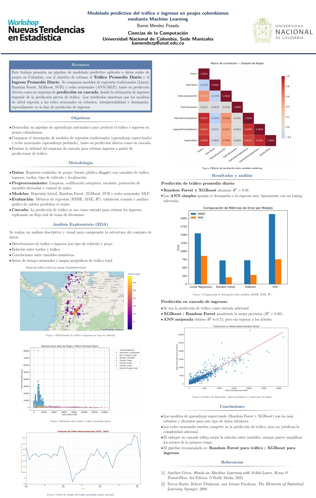

# Modelado predictivo del tráfico e ingresos en peajes colombianos

Proyecto de **Bamsi Mendez Posada**, estudiante de Ciencias de la Computación de la Universidad Nacional de Colombia, Sede Manizales. Presentado como primer póster en el **Workshop Nuevas Tendencias en Estadística (2025)**.

Comparación de regresión lineal, Random Forest, XGBoost, SVR y redes neuronales multicapa para estimar tráfico diario y explorar predicción de ingresos en cascada.

[Póster original](poster/Poster_peajes_2025.pdf) · [Informe técnico](informe/Informe_peajes_2025.pdf) · [Fuente LaTeX](informe/Informe_peajes_2025.tex) · [Notebook](notebooks/01_analisis_historico.ipynb)



## Datos y pregunta

El CSV procesado contiene **26.986 registros**, **119 nombres de peajes** y categorías I–VII, con intervalos entre el **1 de enero de 2019 y el 28 de febrero de 2022**. Cada fila corresponde a una estación, categoría e intervalo de registro. Se utilizan tarifa, tipo de vehículo, peaje y duración para predecir tráfico promedio diario.

El ingreso del conjunto es **calculado** como tarifa × tráfico; no es una medición contable independiente del recaudo. El alcance es exploratorio: la división aleatoria histórica no demuestra pronóstico de meses futuros ni generalización a estaciones nuevas.

## Resultados históricos respaldados

Métricas recuperadas de las salidas guardadas de un notebook intermedio; no corresponden a un reentrenamiento. Los errores de tráfico se expresan en vehículos/día. División aleatoria 80/20, semilla 42.

| Modelo | RMSE | MAE | R² |
|---|---:|---:|---:|
| Regresión lineal | 1541,168 | 855,364 | 0,463083 |
| Random Forest | 718,597 | 204,994 | 0,883271 |
| XGBoost | 723,813 | 276,794 | 0,881571 |
| SVR | 2126,629 | 754,138 | -0,022328 |
| MLP simple | 727,60 | 257,37 | 0,8803 |

Los ensambles y el MLP alcanzaron resultados próximos en tráfico. La pequeña diferencia entre modelos requiere validación adicional antes de afirmar superioridad estable. Para ingresos, el póster reporta R² > 0,80 en árboles y aproximadamente 0,73 en ANN mejorada; no se conservaron las salidas completas que permitirían una tabla detallada.

## Revisión metodológica de noviembre de 2026

El informe complementa el trabajo original y explica sus límites:

- La cascada clásica ajusta el primer modelo sobre todo el conjunto antes de separar la segunda etapa: hay fuga de información.
- Las redes ajustan algunas transformaciones antes de separar entrenamiento y prueba; además, se comparan variantes usando la misma prueba.
- La validación cruzada mencionada en el póster no está acreditada por el código de las métricas principales.
- Las coordenadas están intercambiadas en el CSV: `Lat` contiene longitud y `Lon`, latitud. El mapa conservado en el notebook usa el orden corregido.
- Las duraciones usan diferencia de fechas sin sumar un día. La inclusión de los extremos requiere confirmar la definición de la fuente.
- La referencia `ingreso_predicho = tarifa * trafico_predicho` debe compararse antes de justificar otra etapa aprendida.

El póster se conserva como documento histórico. Su inclusión no implica que esas limitaciones hayan sido corregidas en los experimentos originales.

## Evaluación adicional ejecutada en 2026

Se ejecutó el script de referencia con Python 3.11.13 y scikit-learn 1.8.0. La división aleatoria reproduce las métricas históricas del bosque hasta los decimales disponibles. La división temporal entrena con datos anteriores a 2021 y prueba desde enero de 2021.

| División | Entrenamiento / prueba | RMSE tráfico | R² tráfico | RMSE ingreso (COP/día) | R² ingreso |
|---|---:|---:|---:|---:|---:|
| Aleatoria | 21.588 / 5.398 | 718,597 | 0,883271 | 7.504.216 | 0,877691 |
| Temporal | 16.705 / 10.281 | 1169,650 | 0,790748 | 12.789.478 | 0,767151 |

El ingreso usa tarifa × tráfico predicho, sin segundo modelo. Los conjuntos evaluados difieren: esta comparación ilustra sensibilidad al criterio de separación y no estima por sí sola un efecto causal. La prueba temporal contiene categorías de estación o duración ausentes en entrenamiento, que se codifican con `handle_unknown='ignore'`. Los resultados completos y versiones están en los JSON `resultados/referencia_*.json`.

## Organización

| Ruta | Contenido |
|---|---|
| `poster/` | Póster con referencias y vista previa ligera |
| `informe/` | Informe retrospectivo y fuente LaTeX |
| `notebooks/` | Versión editorial consolidada, sin salidas pesadas |
| `datos/` | CSV recibido, procedencia y diccionario |
| `figuras/` | Figuras históricas seleccionadas |
| `resultados/` | Métricas históricas, estadísticas y auditoría |
| `scripts/evaluar_referencia.py` | Evaluación adicional de RF y referencia multiplicativa |
| `docs/` | Selección de archivos, cambios y guía de publicación |

## Ejecución

Desde la raíz del repositorio, en PowerShell, con Python 3.11 o 3.12:

```powershell
py -3.11 -m venv .venv
.\.venv\Scripts\python.exe -m pip install -r requirements.txt
.\.venv\Scripts\python.exe scripts/evaluar_referencia.py --division aleatoria
.\.venv\Scripts\python.exe scripts/evaluar_referencia.py --division temporal
```

El script ajusta transformaciones y bosque exclusivamente sobre entrenamiento. Genera JSON separados en `resultados/` con versiones y métricas. La división temporal entrena con intervalos finalizados antes de enero de 2021 y prueba intervalos iniciados desde esa fecha. No constituye una reproducción completa de las redes o de la cascada histórica.

Para recrear solo el entorno mínimo utilizado en esa comprobación, instala `requirements-validacion.txt` en un entorno separado con Python 3.11.

Para abrir el notebook:

```powershell
.\.venv\Scripts\python.exe -m jupyterlab
```

Las celdas neuronales requieren las dependencias opcionales:

```powershell
.\.venv\Scripts\python.exe -m pip install -r requirements-neuronales.txt
```

El notebook mantiene decisiones metodológicas de 2025 para documentar el estudio. No debe usarse como una evaluación corregida. No se dispone del entorno congelado original ni de modelos serializados. Consulte [validación](docs/VALIDACION.md) para conocer las comprobaciones realizadas y los límites de reproducción.

## Compilar el informe

Con una distribución LaTeX instalada, desde `informe/`:

```powershell
pdflatex -interaction=nonstopmode -halt-on-error Informe_peajes_2025.tex
pdflatex -interaction=nonstopmode -halt-on-error Informe_peajes_2025.tex
```

## Procedencia y uso

El póster menciona Kaggle, pero los archivos recibidos no identifican de forma inequívoca la página ni la licencia del conjunto original. Consulte [datos/README.md](datos/README.md). El CSV se conserva como insumo del trabajo, sin atribuirle una licencia nueva. Tampoco se añade una licencia general que conceda derechos sobre material de terceros.

## Referencia del proyecto

Mendez Posada, B. (2025). *Modelado predictivo del tráfico e ingresos en peajes colombianos mediante Machine Learning*. Póster, Workshop Nuevas Tendencias en Estadística, Universidad Nacional de Colombia, Sede Manizales. Informe retrospectivo y organización para repositorio: noviembre de 2026.
